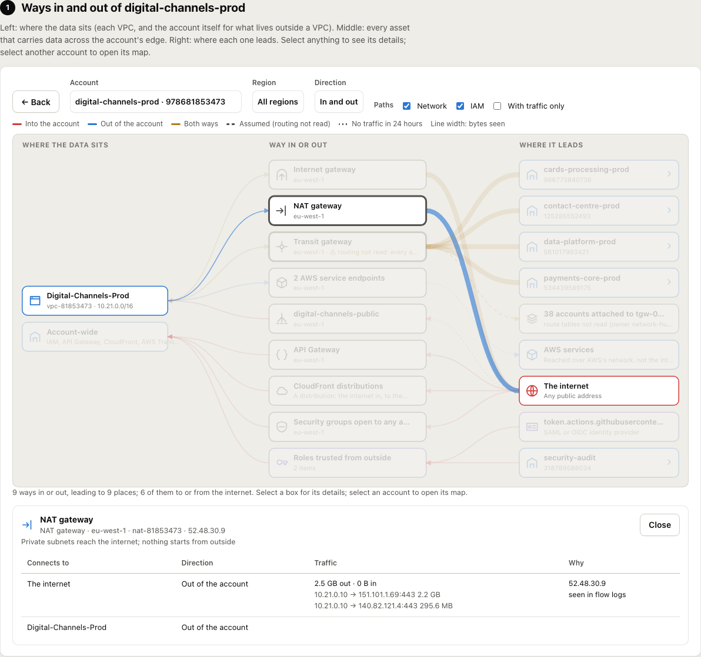
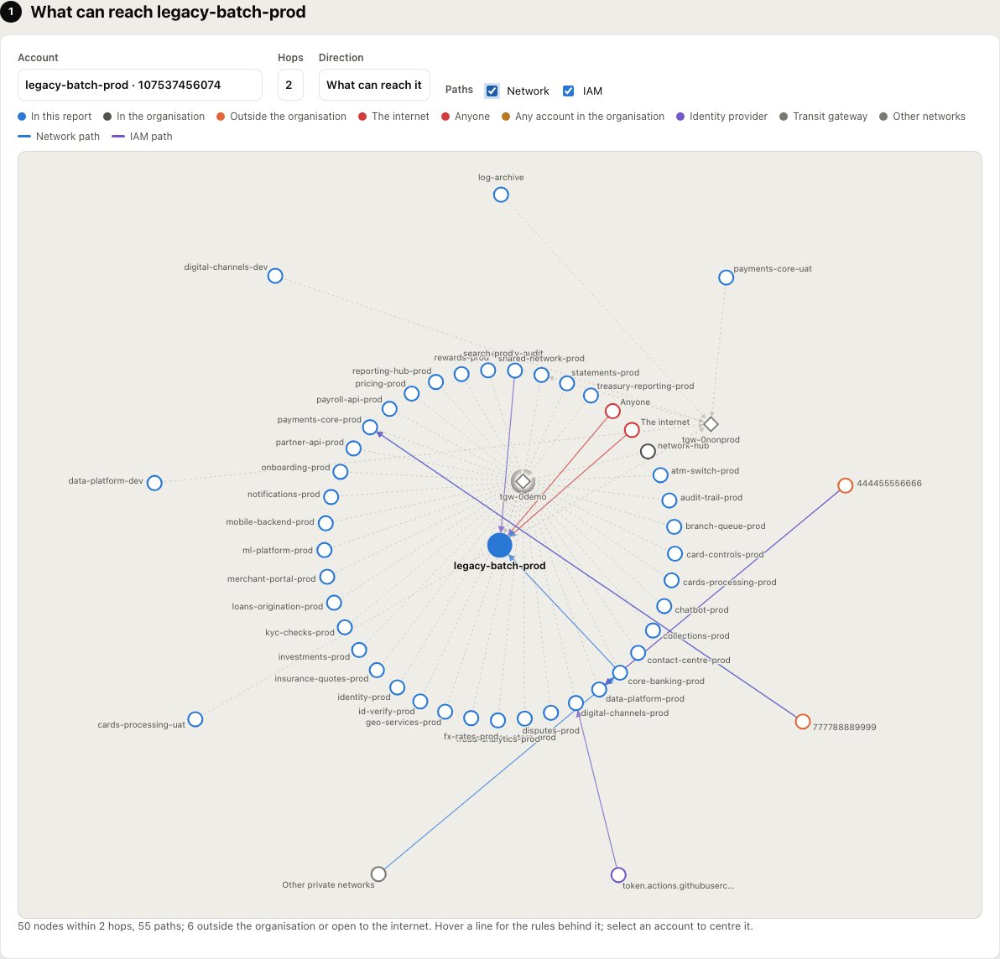

# Access Graph

A part of the Cloud Assurance report, with two views:

- **Account map** (the default): one account's ways in and out. Every asset that moves data across the
  account's edge, drawn with an icon for its kind, and where each one leads. With flow logs read, the
  traffic each one carried in the last 24 hours.
- **Organisation reach**: what can reach any account, a chosen number of hops out.

## Account map

Three columns:

1. **Where the data sits**: each VPC of the account, and "Account-wide" for what lives outside a VPC
   (IAM, API Gateway, CloudFront, AWS Transfer, PrivateLink services).
2. **Way in or out**: the asset that carries data across the edge.
3. **Where it leads**: the internet, AWS services, on-premises networks (a VPN's customer gateway, a
   Direct Connect location), other accounts (in the organisation or not), anyone, identity providers.

Each line shows its direction: into the account (red), out of it (blue) or both ways (amber). A dashed
line is assumed (a transit gateway whose route tables were not read); a dotted line is a path the flow
logs cover that carried nothing in the window: a candidate to close. Line width is the bytes seen.

Select a box for its details (every item behind it, its warnings, each line with its traffic and the
largest conversations). Select an account on the right, or in the table below the map, to open that
account's map; **Back** returns. Filter by region, direction, network or IAM, and "with traffic only".

| Asset | Icon | Direction | Leads to | Read with |
|---|---|---|---|---|
| Internet gateway | arch with arrow | both | the internet; flagged when no route table uses it | `ec2:DescribeInternetGateways`, `ec2:DescribeRouteTables` |
| Egress-only internet gateway | arrow up | out | the internet (IPv6) | `ec2:DescribeEgressOnlyInternetGateways` |
| NAT gateway | arrow through a wall | out | the internet (public NAT) or other private networks (private NAT) | `ec2:DescribeNatGateways` |
| Transit gateway | hub | both | the accounts and on-premises networks its route tables send to and receive from | `ec2:DescribeTransitGatewayAttachments`, `ec2:DescribeTransitGatewayRouteTables`, `ec2:GetTransitGatewayRouteTableAssociations`, `ec2:GetTransitGatewayRouteTablePropagations`, `ec2:SearchTransitGatewayRoutes`, `ec2:DescribeTransitGatewayPeeringAttachments` |
| VPC peering | two linked circles | both | the peer account | `ec2:DescribeVpcPeeringConnections` |
| VPN gateway | padlock | both | each VPN's customer gateway, with tunnels up | `ec2:DescribeVpnGateways`, `ec2:DescribeVpnConnections`, `ec2:DescribeCustomerGateways` |
| Direct Connect | lightning | both | the Direct Connect location | `directconnect:DescribeVirtualInterfaces` |
| AWS service endpoints | cube | out | AWS services; flagged when a policy allows everything | `ec2:DescribeVpcEndpoints` |
| PrivateLink endpoint | chain | out | the provider account, or the service when its owner is not scanned | `ec2:DescribeVpcEndpoints` |
| PrivateLink service | chain | in | the principals allowed to connect | `ec2:DescribeVpcEndpointServicePermissions` |
| Public load balancer | fan | in | the internet | `elasticloadbalancing:DescribeLoadBalancers` |
| API Gateway | braces | in | the internet, or private networks for private APIs | `apigateway:GET` |
| CloudFront | cloud | in | the internet, with each distribution's origins | `cloudfront:ListDistributions` |
| AWS Transfer | folder | in | the internet for public servers | `transfer:ListServers` |
| Public addresses | pin | both | the internet; network interfaces with a public IPv4, grouped by what owns them | `ec2:DescribeNetworkInterfaces` |
| Open security groups | shield | in | the internet: groups in use that admit `0.0.0.0/0` | `ec2:DescribeSecurityGroups` |
| Role trusts, bucket policies | key, bucket | in | the outside principals they trust | `iam:GetAccountAuthorizationDetails`, `s3:GetBucketPolicy` |

Optional reads that are refused (Direct Connect, API Gateway, AWS Transfer, transit gateway routing) are
named on the report; the rest of the map stands.

### Transit gateways

Followed through their route tables when the gateway's owner is in the scan (route tables are only
visible to the owner). The account reaches what the table associated with its attachment routes to,
and is reached from every attachment whose table routes to it; blackhole routes are flagged, an
attachment with no associated table sends nowhere, and a peering attachment leads to the peer
gateway's owner. When the owner is not scanned, every attached account is shown folded into one
"N accounts attached" box, dashed, marked assumed.

The Organisation reach view uses the same tables: two accounts are joined only when a route between
them exists, and a security-group range counts only over such a route.

### Flow-log evidence

Tick **Also read VPC flow logs and refused API calls for the account map** under Cloud Assurance in New scan (or
`exitrisk scan --assurance --access-flows`). Off by default: CloudWatch Logs Insights is billed per GB
of logs scanned (about $0.005 per GB). For each region, one Insights query per flow-log format reads the
last 24 hours of accepted traffic from flow logs delivered to CloudWatch Logs: the largest 2,000
conversations by bytes (source, destination, port) and the total. Formats with `pkt-srcaddr` and
`pkt-dstaddr` are read through them, so traffic behind a NAT keeps its real ends. Flow logs kept only
in S3 are named, not read. Needs `logs:StartQuery`, `logs:GetQueryResults` and `logs:StopQuery`.

Each conversation is placed on the line it crossed: the local address's subnet, that subnet's route
table, the longest route matching the far address (a NAT gateway's own address goes to the NAT). The far
address names the destination: another scanned account's VPC range, the internet, or the on-premises
network behind a VPN gateway. Traffic between the account's own VPCs stays inside. "What crossed the
edge" reports how much was placed, stayed inside or could not be placed. AWS service addresses reached
through a gateway endpoint (a prefix-list route) count as the internet.

Traffic is split into the account and out of it, overall and for each conversation. Flow logs that
record rejected traffic (traffic type ALL or REJECT) are also read for refused attempts: a red marker on
the line they were refused on, and a table of the most attempted (direction, from, to, port, line,
attempts), with the count from the internet called out. With accepted-only flow logs the report says so.

### Failed and blocked traffic

Section 2 of the account map lists everything turned away at the account's edge in the last 24 hours.
Every kind is listed even when its count is 0, and each says where it happened. A kind with nothing to
measure says "none in this account"; one that was not read says why.

VPC flow logs record only whether a connection was accepted or refused, never HTTP status codes. The
codes come from CloudWatch metrics on the load balancers, API Gateway and WAF.

| Where | What | Source |
|---|---|---|
| Flow logs | Connections security groups and network ACLs refused, in (and from the internet) and out | Flow logs of traffic type ALL or REJECT, with the flow-log option |
| CloudTrail | API calls refused (access denied, unauthorised, bad signature) and failed console sign-ins | Trails delivered to CloudWatch Logs, with the flow-log option |
| WAF | Requests blocked by web ACL rules (regional, and CloudFront in us-east-1) | `AWS/WAFV2` BlockedRequests |
| Network Firewall | Packets dropped by firewall rules | `AWS/NetworkFirewall` DroppedPackets |
| Network load balancers | Flows the load balancer's security group blocked (in and out), resets by the load balancer and by targets, failed TLS handshakes | `AWS/NetworkELB` |
| Application load balancers | 4xx and 5xx the load balancer returned, 5xx from targets, connections rejected at the limit, failed TLS handshakes | `AWS/ApplicationELB` |
| API Gateway | 4xx (denied, unauthorised, throttled) and 5xx, REST and HTTP APIs | `AWS/ApiGateway` |
| PrivateLink | Connections reset by this account's endpoint services, packets dropped at interface endpoints | `AWS/PrivateLinkServices`, `AWS/PrivateLinkEndpoints` |
| Databases | Connections refused to database ports (PostgreSQL, MySQL, SQL Server, Oracle, Redis and others) in the flow logs; failed sign-ins on Aurora MySQL | Flow logs; `AWS/RDS` LoginFailures |
| NAT gateways | Connections that failed for want of a source port, packets dropped | `AWS/NATGateway` |
| Transit gateways | Packets dropped by blackhole routes or for no route (in the owner account) | `AWS/TransitGateway` |

The metrics are read in every scan with Cloud Assurance: one GetMetricData round per region with
SEARCH expressions (`cloudwatch:GetMetricData`, already in the role). Most failure metrics are published
only when non-zero, so each kind's resources are counted from a metric that is always published: "1
checked, none failed" is a true 0. Load balancers, transit gateways, NAT gateways, API Gateway and
PrivateLink resources with failures are flagged on the map.

Below the table, three lists to spot someone mapping the estate:

- **Addresses refused at the network**: each far address with its attempts, the ports and addresses it
  tried and the other scanned accounts that refused it too. Five or more ports or addresses (the shape
  of a scan), or a refusal in another account, is highlighted.
- **Callers refused by AWS**: each caller and source address with the calls refused, how many different
  calls and the other accounts that refused the same internet address. Ten or more different calls (the
  shape of someone listing what a credential can reach) is highlighted.
- **Across every scanned account**: internet addresses refused anywhere in the scan, most accounts
  first, and whether the same address was refused both at the network and by AWS.

CloudTrail is read with Logs Insights from each trail whose CloudWatch Logs group is in the scanned
account, so an organisation trail read in the management account covers every account. Include the
management account (or the account holding the trail's log group) in the scan. Billed per GB scanned
like the flow logs, so it is read only with the flow-log option.

### Networks outside the account

Ranges the account can reach that are not its own VPCs nor another scanned account's: routes in its VPC
route tables to a transit gateway, VPN gateway or Cloud WAN, transit gateway routes, VPN static routes,
Direct Connect virtual interfaces and security-group rules that admit a range. Name your data centre
ranges in **On-premises ranges** above the map (`10.200.0.0/16 Johannesburg DC`, one per line or comma;
`exitrisk report --view access --onprem "..."`); the console remembers them. Unnamed private ranges
show as "Other private networks", public ones as "Specific internet addresses".

### S3 buckets

Every bucket in the account with its access: public, shared outside the account (and with whom), or the
account only, plus network limits a bucket policy enforces (a Deny for every request unless it comes
from a named VPC endpoint, VPC, IP range or the organisation), TLS only, KMS, ACLs, versioning, Object
Lock, replication and classification. Network limits need a new scan.

### Lambda functions

Each function's reach: the internet directly (no VPC, or a default route to a NAT or internet gateway),
through a central egress (default route to a transit gateway or Cloud WAN, shown as assumed) or not at
all, the outside networks its subnets route to (data centre, Direct Connect, VPN), and function URLs
open to anyone. Needs a new scan; uses `lambda:ListFunctions` and `lambda:ListFunctionUrlConfigs`
(the first 300 functions per region).

### Selecting and exporting

Select a box to see only what touches it. Select it again, click the empty map, press Escape or choose
Show everything to see the whole map again. Export to PDF prints the account map and the organisation
reach together, with every table; the PDF is named after the report, the account and the scan date.

## Organisation reach

**What can reach me?** opens the view: every source with a path into the chosen account within the hops and path kinds chosen, grouped worst first (the internet and anyone, outside the organisation, any account in the organisation, data centres and other networks, accounts in the organisation directly, then through another account). Each row gives how it gets in, network or IAM, hops and the rule behind it. Accounts let in by the same rule share a row.

It answers one question for any account in the scan: **what can reach it?** Other accounts in the
organisation, accounts outside it, identity providers, anyone, and the internet, over the network and
through IAM. Pick an account, how many hops out to follow (1 to 5) and the direction:

- **What can reach it**: every source with a path in, and the sources that can reach those, and so on;
- **What it can reach**: the same walk outwards;
- **Both**.

Network and IAM paths can be shown together or on their own. Select an account in the graph or in
"Most reachable accounts" to put it at the centre. Hover a line for the rules behind it.

## What is read

Read with the Cloud Assurance checks in each account and region, read-only. A scan with Cloud Assurance
ticked has both views; only the flow-log evidence is a separate option.

| Path | Edge | Read with |
|---|---|---|
| Transit gateway | The gateway's route tables send the source to the target; with the tables not read, every account attached to a gateway reaches every other account on it | `ec2:DescribeTransitGatewayAttachments`, and the route-table reads above |
| VPC peering | Both ways between the requester and accepter accounts (active peerings only) | `ec2:DescribeVpcPeeringConnections` |
| PrivateLink | A principal allowed on an endpoint service reaches its owner; an endpoint to another account's service reaches that account | `ec2:DescribeVpcEndpointServiceConfigurations`, `ec2:DescribeVpcEndpointServicePermissions`, `ec2:DescribeVpcEndpoints` |
| Security group reference | A group in use admits another account's group | `ec2:DescribeSecurityGroups`, `ec2:DescribeNetworkInterfaces` |
| Security group range | A group in use admits a range that overlaps another scanned account's VPC, **and** a route exists between the two (a shared transit gateway or a peering) | as above, plus `ec2:DescribeVpcs` |
| Open to the internet | A group in use admits `0.0.0.0/0` | as above |
| Role trust | A role trusts a principal outside the account | `iam:GetAccountAuthorizationDetails` |
| Bucket policy | A bucket policy allows a principal outside the account | `s3:GetBucketPolicy` |

A security-group range no scanned VPC owns goes to **Other private networks** (on-premises, partners,
accounts not in the scan) when it is private, and **Specific internet addresses** when it is public.
A trust or grant of `*` is **Anyone**, unless a condition limits it to the organisation
(`aws:PrincipalOrgID`, `aws:PrincipalOrgPaths`: **Any account in the organisation**) or names accounts
(`aws:PrincipalAccount`, `aws:PrincipalArn`: those accounts). Service principals and the account's own
principals are not paths. Role trusts note when they need an external id.

Only account ids, role and bucket names, CIDRs, ports and resource ids are kept.

## Hops

A hop is one step from a source to what it reaches. A transit gateway is passed through, not counted:
two accounts on one gateway are one hop apart, as they are for traffic. With the route tables read the
two are joined directly; without them the gateway is drawn as a diamond with dashed lines to its members.

## What it does not evaluate

An edge means a path exists, not that it is used, and not that it is wrong. Network ACLs, SCPs, RCPs,
permission boundaries, session policies, Cloud WAN, Gateway Load Balancers and Network Firewall are
not evaluated, so a drawn path may be blocked (or inspected) further along. VPC route tables are used by
the account map to tie gateways to VPCs and to place flow logs; the Organisation reach view does not
read them. Transit gateways owned outside the scan cannot have their route tables read. Lambda function
URLs, App Runner, AppSync, IoT and Global Accelerator are not yet drawn as ways in.

To act on what the map shows, [sg-tightener](https://github.com/andrewbakercloudscale/sg-tightener)
narrows broad security-group ranges to the sources flow logs actually saw reach each group.

Each list is kept to 1,000 entries per account and region; the report says when one was cut.
